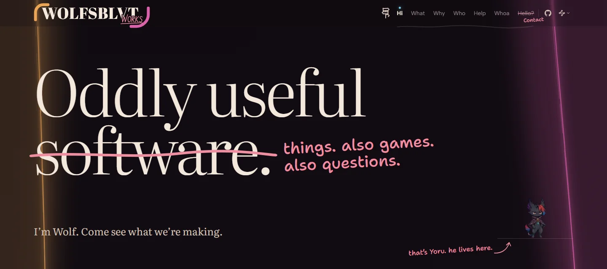

<h1 id="wolfsblvt-works">
  <picture>
    <source media="(prefers-color-scheme: dark)" srcset="brand/bundle/works/assets/lockup-default/on-dark.svg">
    
  </picture>
</h1>

[](https://github.com/Wolfsblvt/wolfsblvt.works/actions/workflows/verify.yml)


**Oddly useful ~~software.~~ things. also games. also questions.**

The home of Wolf's software, experiments, and ideas: what he's making, what drew him in, and what might be worth
following next. One long walk past projects, the reasons behind them and the people making them—with a pile of
everything else near the bottom. Come with something in mind, or see what catches your eye.

**[Visit wolfsblvt.works](https://wolfsblvt.works/)** · [Explore the Pile](https://wolfsblvt.works/#whoa) ·
[Say hello](https://contact.wolfsblvt.works/) · [Documentation](docs/README.md)



## Take the Walk

- **[Find a project](https://wolfsblvt.works/#what).** Pull-request tools, floating nations, smaller images, karaoke
  automation, embodied companions: diffdevil, Borrowed Coast, smolpng, Karaokebarr and Lunescence each have their own
  window and voice. Their stages differ; the windows carry the current story and next step, including work in
  progress and early concepts.
- **[Rummage through the Pile](https://wolfsblvt.works/#whoa).** Ideas, small projects, notes and odd little artifacts,
  dealt afresh each day. Open **“There's more. A lot more.”** to spread out the whole collection without leaving
  the page.
- **Meet [the reasons](https://wolfsblvt.works/#why) and [the people](https://wolfsblvt.works/#who).** If you like what
  we're making, [Help](https://wolfsblvt.works/#help) explains what sponsorship sustains and where to chip in.

The [visitor guide](docs/exploring-works.md) has the landmarks and a little more about how the place works.

## Oh, and Yoru lives here

He has places to be, naps to take, and opinions about being poked. On the site, he keeps you company as you wander.

<picture>
  <source media="(prefers-reduced-motion: reduce)" srcset="docs/assets/readme/yoru-still.png">
  
</picture>

[A still moment](docs/assets/readme/yoru-still.png) · [Artwork and media sources](docs/assets/readme/README.md)

## Write to Wolf

An idea, a question, a connection, a hello: [contact.wolfsblvt.works](https://contact.wolfsblvt.works/) is the shared
contact form for every Wolfsblvt project. A successful send delivers your message to Wolf's inbox and a copy to yours.
[Linking from a product](docs/exploring-works.md#one-contact-page) can preselect that project.

## Private by construction

No analytics or tracking, no cookies or browser storage for the site's own purposes. Fonts are self-hosted;
Cloudflare Turnstile on the contact page is the only third-party script. The [privacy page](https://wolfsblvt.works/privacy/)
explains hosting, security checks and what happens when you write. Dark only, on purpose; reduced motion is welcome.

## Run it locally

This repository contains the Astro site and its Cloudflare Worker. You need **Node.js 22.12 or later** (24 recommended),
npm and Git.

```sh
git clone https://github.com/Wolfsblvt/wolfsblvt.works.git
cd wolfsblvt.works
npm install
npm run dev
```

Open <http://localhost:4321>: you should see the Walk, its project windows and the Pile. This static preview uses
fixture legal data; contact submissions need the [local Worker setup](docs/DEVELOPMENT.md#bootstrap), which sends no
mail. `npm run check` runs the full verification.

[Development](docs/DEVELOPMENT.md) covers the commands and checks · [Architecture](docs/ARCHITECTURE.md) explains the
moving parts · [Vision](docs/VISION.md) keeps the larger destination · [Documentation](docs/README.md) is the full map.

## License

Code is [AGPL-3.0-only](LICENSE.md), original prose is CC BY 4.0, and the Works marks, Yoru and other artwork remain
reserved. The [licence map](LICENSES/README.md) explains the boundaries.
