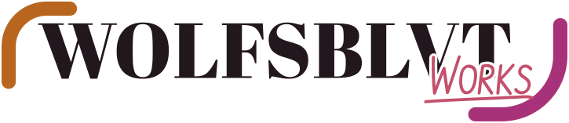

# Wolfsblvt Works assets

Approved, reusable Works artwork for websites, GitHub READMEs, sponsorship profiles and project credits. **Start here for SVG, PNG or animated exports.** These files are tracked and usable without knowing how the designs were commissioned.



| Need | Use |
| --- | --- |
| Full logo that follows light/dark preference | [Adaptive lockup](brand/svg/lockup/works-lockup.svg) |
| Compact logo (24–39px tall) | [Adaptive compact lockup](brand/svg/lockup/works-lockup-compact.svg) |
| Works mark/icon | [Adaptive icon](brand/svg/icon/works-icon.svg) |
| Sponsorship graphic | [Adaptive sponsor banner](brand/svg/sponsor/works-sponsor-banner.svg) |
| Explicit static theme variants | [SVG icons](brand/svg/icon/), [SVG lockups](brand/svg/lockup/), [SVG banners](brand/svg/sponsor/) |
| PNG alternatives | [Icons](brand/png/icon/), [lockups](brand/png/lockup/), [sponsor banners](brand/png/sponsor/) |
| Animation | [GIF](brand/animated/gif/), [APNG](brand/animated/apng/), animated SVGs in the SVG folders |
| Visual inspection and downloads | [Gallery](brand/assets.html) (serve files over HTTP) |

## Embedding in GitHub

**One SVG:** `assets/brand/svg/lockup/works-lockup.svg` includes both colour treatments and an internal `prefers-color-scheme` rule. Modern browsers that support media queries in linked SVG images choose automatically.

**Most dependable in GitHub READMEs and profiles:** use `<picture>` with the explicit static dark/light SVGs. The light variant is the default/fallback; `-dark` is for dark backgrounds, `-light` is for light backgrounds. When embedding from another repository, use absolute raw URLs:

```html
<picture>
  <source media="(prefers-color-scheme: dark)" srcset="https://raw.githubusercontent.com/Wolfsblvt/wolfsblvt.works/main/assets/brand/svg/lockup/works-lockup-dark.svg">
  
</picture>
```

Use the same pattern with `works-sponsor-banner-dark.svg` and `works-sponsor-banner-light.svg` for funding pages. Explicit variants remain because not every image renderer honors SVG media queries. The theme-aware versions are conveniences, not replacements for predictable static colour files.

## Asset ownership

- **`assets/brand/`** contains ready-to-use exports and the [gallery](brand/assets.html). The website's header, footer, favicon and social card generation consume this stable home.
- **`design/marks/`** contains the [editable generator, geometry and decisions](../design/marks/README.md), exploratory canvases and design-only sponsorship specimens. Run [the generator](../design/marks/source/build.mjs) to regenerate approved exports here, rather than into a numbered handoff return.
- **`src/components/WorksSponsor.astro`** and **`src/styles/sponsor.css`** are the website's real production sponsor panel, not a parsed demonstration.
- **`@wolfsblvt/icons`** owns reusable semantic UI glyphs, not full-colour lockups, large sponsor artwork or downloadable PNGs.
- **`public/`** contains *served* identity projections generated for this website. The reusable originals remain here under `assets/`.

These marks and artworks are reserved. See the [licence boundaries](../LICENSES/README.md). Downloadability is not a licence to reuse the Wolfsblvt Works identity for another entity. Preserve the approved lettering, corners and palette.
